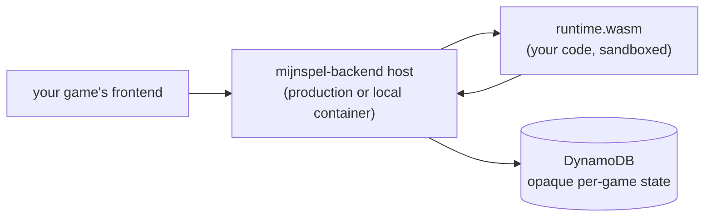

# Building a game on `mijnspel-backend`

The `mijnspel-backend` host is game-agnostic. Per-game logic ships as a
pair of WebAssembly modules — `runtime.wasm` and `migration.wasm` —
authored against the public
[`mijnspel-sdk`](https://github.com/xafron-bv/mijnspel-sdk) Rust crate
and uploaded to the host operator via the manual intake protocol.

This guide walks you through:

- [Prerequisites and project layout](./quickstart.md)
- [The ABI: how the host calls into your WASM](./abi-reference.md)
- [Runtime exports](./runtime-exports.md) — the request-path callbacks
- [Migration exports](./migration-exports.md) — schema steppers
- [State and versioning](./state-and-versioning.md) — what
  `schemaVersion` actually means
- [Lobbies and signals](./lobbies-and-signals.md) — multi-player
  primitives and per-session signal channel
- [Local development](./local-development.md) — how to use the
  published Docker image to run the full backend offline
- [Submitting your WASM](./intake-submission.md) — what the operator
  expects when you email artifacts in
- [Troubleshooting](./troubleshooting.md)

## At a glance



The host owns:

- **All I/O** — DynamoDB, S3, SQS, WebSocket, WebPush. Your WASM
  cannot reach any of these even if it tries; it has no host imports.
- **Tenancy enforcement** — every request is scoped to one `appId`
  (yours).
- **Auth, transport, validation envelopes**.
- **Schema migrations** — your WASM provides the pairwise steppers; the
  host orchestrates the walk.

You own:

- **Per-game state shape** — the host stores it as opaque JSON.
- **Validation rules** — what's a legal create/update for your game.
- **Outcome computation** — given a current state and a request,
  what's the new state and what stat updates fall out?
- **The set of stats** — there's no built-in rating, leaderboard, or
  achievement system. You declare which stat ids matter; the host
  routes the values.

## What this guide covers, and what it doesn't

This guide is everything you need to build, test, and submit per-game
WASM modules for the host. It assumes you have:

- The `mijnspel-sdk` crate, installed as a Git dependency from
  <https://github.com/xafron-bv/mijnspel-sdk> (see [quickstart](./quickstart.md)).
- The `ghcr.io/xafron-bv/mijnspel-dev-server:latest` Docker image.
- An admin contact for the host operator (for the manual intake step).

It does **not** describe the host's internals (how the dispatcher
loads modules, what the AWS resource layout is, how the registry
cache invalidates). You don't need that to ship a game — the wire
contract documented here is stable across host versions identified by
`HOST_ABI_VERSION`.

For the JSON wire types, generate the SDK's Rust docs locally:

```
cargo doc --open -p mijnspel-sdk
```
